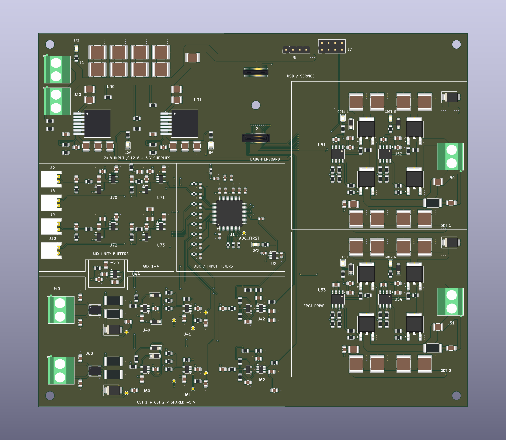

# Compact square placement

> Historical milestone: later placement, package, contact-map and routing changes are documented in [COMMAND-AND-ADC-CLEANUP.md](COMMAND-AND-ADC-CLEANUP.md). Use `circuit.json`, `daughterboard-pinout.csv`, and the latest validation reports for current state.

> Historical milestone. The current analog routing/channel swap and removal of command-enable gates are described in [ANALOG-AND-DRIVE-CLEANUP.md](ANALOG-AND-DRIVE-CLEANUP.md). Counts, U50/U55 references, and incremental routing recipes below describe the earlier revision; use `tesla_route_reviewed.py` for the current circuit.

The board is **174 × 155 mm**. The extra 28 mm of width separates the GDT column from the analog input rows and brings the ADC back near the FPGA. Corner mounting holes follow the outline. The daughterboard retains its frozen connector spacing, midpoint screw and 45 × 20 mm envelope.

## Arrangement

- **Upper left — one power rectangle:** battery connectors, eight-part input reservoir and both 12 V/5 V converters share a 68 × 49 mm region. The previous combined bounding area was 88 × 65 mm; this is about 42% smaller. Capacitor quantities, packages and electrical values are unchanged.
- **Lower left — two matching CST rows:** one 93.2 × 42 mm region holds both channels. Their phase circuits sit to the right of their rectifiers. Header pitch is 17 mm; the shared −5 V generator sits above the channels. The schematic channels remain separate. See [the compact layout preview](cst-condense.png) and [verification](cst-condense-review.json).
- **Top center — daughterboard:** connectors and mounting hole translate together to the smaller board, without changing mating geometry. Service headers remain accessible alongside/below it.
- **Below the daughterboard — ADC and reference/filter parts:** analog filters face the CST circuitry. The northern capacitor row follows AVCC, REFCAP, REF, REGCAP_D, AVCC and REGCAP_A pin order. C1 is at the southern AVCC pin; C5 is beside eastern VDRIVE. C3 supplements the shared northern supply-pair bypass; C10 is bulk bypass. See `adc-capacitor-placement.csv` for measured pin-center distances. The primary capacitors are about 2.5–4.5 mm from their pins; C3 is 6.5 mm away. These 0805 footprints cannot all sit within the default 2 mm center-distance rule along the 0.5 mm-pitch lead row. Short individual fan-outs and local ground returns still need routing and review.
- **Right — matching GDT bridges:** 18 mm half-bridge spacing (reduced from 24 mm); each reservoir bank is split into four capacitors above and four below the MOSFET group. All remain on the component face for access. Both low-side MOSFETs now present their switch-node drain toward the high-side source, simplifying the current path. Gate resistors/pull-downs move with their respective gates. The connectors face right; blocking and damping parts are adjacent to them.
- **Below power — compact auxiliary analog inputs:** Four JST-PH connectors J3/J8/J9/J10 face left. Two compact rows of unity-gain buffers and filters sit to their right, directly below the supply section; the ADC is immediately to the right of these rows. See [AUX-INPUTS.md](AUX-INPUTS.md).

Region silk is a user-requested placement aid, not an electrical isolation boundary or copper keepout. Some output/control regions use titles without outlines to avoid adding silk through tight support circuitry.

## Local output copper

`tools/hardware/tesla_route_outputs.py` adds 34 manually specified F.Cu segments. Main switch-node and output links use **2.5 mm width**, no vias and 0/45/90-degree geometry. The damping branch uses 1 mm copper. The main path passes directly through the damping resistor's switch-node pad rather than ending in a small branch stub. Both bridges use identical translated geometry.

For nominal 35 µm outer copper, a uniform 2.5 mm trace is approximately **0.197 mΩ/mm at room temperature** (bulk copper resistivity estimate). This is a trace-resistance estimate, not a measured output impedance or a model of switching-loop inductance. Capacitor impedance, MOSFET resistance, terminal contacts and cable/GDT parasitics still contribute. Supply feeds, reservoir connections, gate/bootstrap circuits, ground returns and thermal copper remain unrouted; the bridge is not electrically complete.

## Reproduction and validation

- `tools/hardware/tesla_placement.json`: all 299 positions, reference positions, outline, regions and module envelope.
- `tools/hardware/tesla_floorplan.py`: applies placement only to an unrouted board and updates the circuit contract. It deliberately refuses to move an already routed board.
- `tools/hardware/tesla_route_outputs.py`: replaces only its own UUID-tagged output segments; it does not erase other routing.
- `docs/output-copper.json`: exact generated segments and lengths.

Native ERC, physical DRC and schematic parity are zero after the change. KiCad still reports 499 unconnected items; substantial routing remains. The separate [quality audit](LAYOUT-QUALITY.md) is not green. All 286 fitted components retain their local STEP models. Top/oblique renders and a native copper plot were reviewed for connector direction, body spacing, support placement and output-path geometry. No fabrication package is published.

Vertical compaction: D50/D51 (SMBJ30A) now sit beside the upper reservoir rows at the right edge. GDT 2 and its control parts moved up 18 mm, reducing channel pitch from 73 to 55 mm. The four-above/four-below reservoir arrangement is preserved; local output copper follows the moved stage. Native checks pass with the existing 499 open connections still pending routing.

J6 remains horizontal between the GDT stages. AUX1–AUX4 have individual 2-pin JST-PH connectors at x=28 mm, y=82/91/100/109 mm, rotated 270° for left-facing cable entry. The ADC is at (93,96) mm, inside a 41 × 41 mm silk border immediately right of the AUX section. CST headers are at (29,130)/(29,147) mm. The shared −5 V pump is above the channels. GDT outputs stay at the right edge.

The daughterboard envelope x=93–113, y=28.2–73.2 mm remains clear of other components; only its two mating connectors and mounting hole are permitted there. This is a component-body clearance check, not a copper keepout.

AUX buffers are compacted into two columns with local bypass retained. AUX plus ADC now spans x=20.8–114 mm (93.2 mm), matching the CST region below. R504, the shared DRIVE_ARM pull-down, is at (144,97) mm beside U50 rather than stranded below the control column. No electrical nets changed.

Latest placement: the daughterboard, H1 and service headers moved 16 mm left, leaving a 2 mm gap between its projected body and the power-region border. Both gate-drive groups, their control parts, J6 and the 34 local output segments moved 20 mm left and 18 mm up. The pair is centered vertically (region centers y=72.5 and 128 mm), retaining 55 mm channel pitch. No other components occupy the daughterboard envelope.

Latest framing pass: daughterboard and service headers lowered 7 mm to align its top with the power region. GDT groups have matching 0.15 mm silk frames and small bottom captions. J6 moved 6 mm down to clear the frame boundary. Outline tightened to x=18–192, y=20–175 mm (174 × 155 mm), retaining corner mounting clearance.

The USB-C programming connector J5 faces the top edge; the former J7 service header is removed. Gate-drive blocks and their existing output copper moved 12 mm upward to close the former upper gap.

Both gate-driver blocks, their support components, and local output tracks moved 5 mm left to reduce the central gap. The placement manifest and output-routing generator retain this offset.

J5 is now an HRO TYPE-C-31-M-12 USB-C receptacle at the top edge, for programming only. D+/D− reach the module through U3 USBLC6-2SC6 protection. VBUS is isolated from VIN_5V; power the controller from its normal supply. R24/R25 provide separate CC pull-downs. R26/R27 report VBUS presence on J1.20 (ESP GPIO8). See usb-c-review.txt.

Latest compact outline: 163 × 148.8 mm, bounds (20.4,20.6)–(183.4,169.4) mm, with 0.4 mm clearance outside the outer subsystem silk frames. Carrier mounting holes H2/H3/H4/H5 are at (25,25), (179,25), (25,165), (179,165) mm: 154 × 140 mm mounting pitch. All four centers and their 6.4 mm mounting courtyards fit within the subsystem envelope; daughterboard mounting H1 is unchanged. Indicators use 3 mm horizontal pitch with 90-degree labels, LEDs and series resistors.

The former octal buffer and top-edge LED bank are removed. Power indicators sit next to J4, U30, U31 and U2; two actual switching-node indicators sit in each GDT section. See [INDICATORS.md](INDICATORS.md) for placements, protection and electrical behavior.

J4/J30 remain aligned at x=27.5 mm; H2/H3 are at y=32, and J5 at (128,30.4) mm with its mouth over the top edge. Top Edge.Cuts is y=27.6, 0.4 mm outside the supply frame. Board dimensions remain 163 × 141.8 mm; mounting pitch is 154 × 133 mm. H1 and the daughterboard envelope are unchanged.
