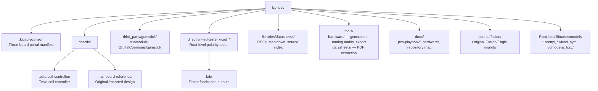

# Repository map

Current workspace structure, 2026-10-20. The manifest registers three boards
(direction tester at the root, MainBoard reference, Tesla coil controller). The
ESP32 + FPGA module, its programming carrier and the GPS calibrator moved to
[OrbitalCommons/gumstick](https://github.com/OrbitalCommons/gumstick) and
[OrbitalCommons/stratumzero](https://github.com/OrbitalCommons/stratumzero) (the GPS calibrator, now named StratumZero).



Each board keeps its own KiCad sources,
project-local symbols/footprints/models, design notes in `docs/`, current
exports in `fab/`, and frozen fabrication snapshots in `releases/`.

```text
boards/<board>/
├── *.kicad_pro / *.kicad_sch / *.kicad_pcb / *.kicad_dru
├── *.kicad_sym / *.pretty/ / 3dmodels/
├── docs/                  design contracts, review notes, drawings
├── fab/
│   ├── checks/            ERC / DRC and other audits
│   ├── gerbers/           copper, mask, silk, outline, drill, ZIP
│   ├── bom/               native BOM / positions / manual assembly
│   └── jlcpcb/            manufacturer BOM / CPL / assembly ZIP
└── releases/<version>/    preserved review or ordered artifacts
```

`tmp/`, `logs/`, `.worktrees/` and uploaded screenshot files are local working
material excluded from Git. The two carriers mate with the same module;
they are separate boards, not daughterboard revisions. RFC v1 ordering waits
for validation of the already ordered module and programmer.
